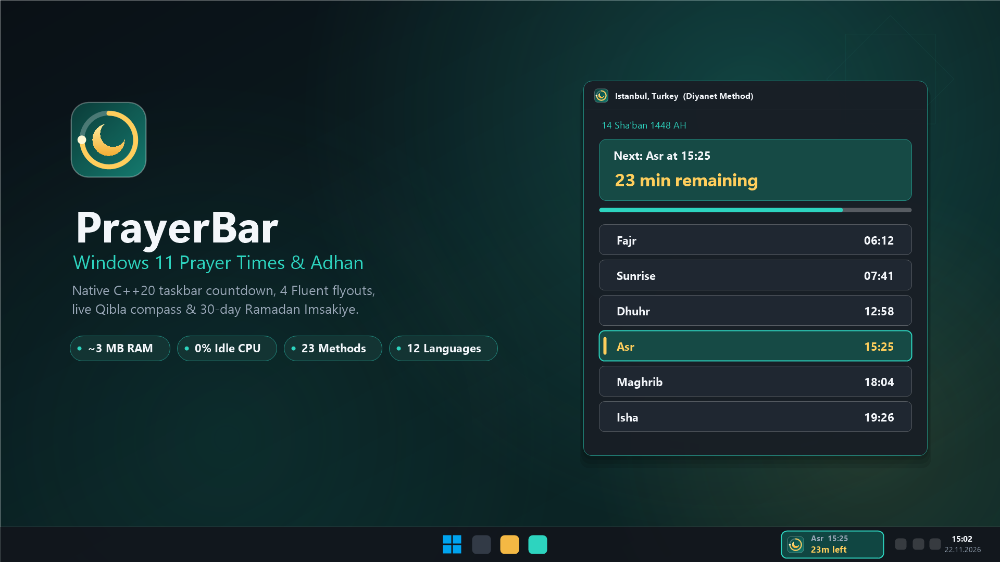
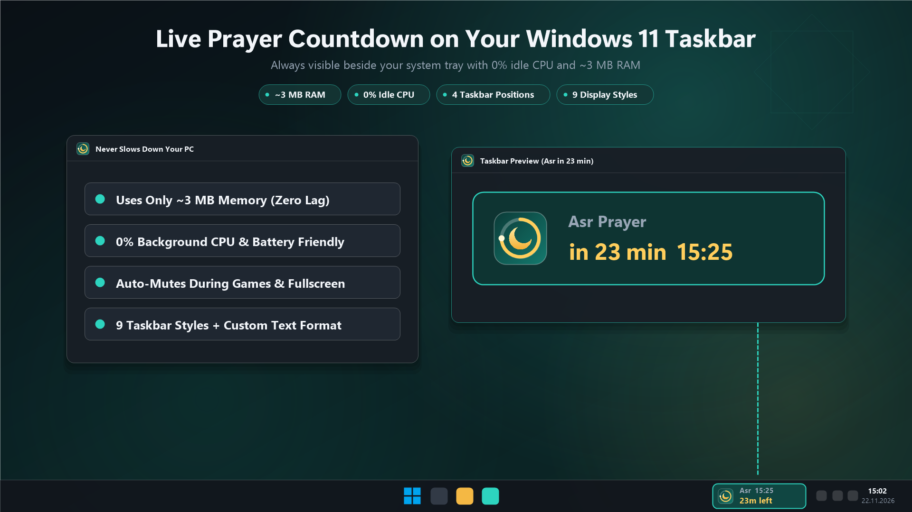
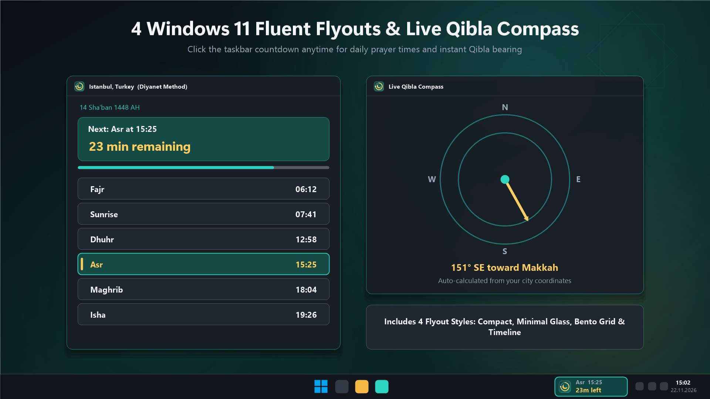
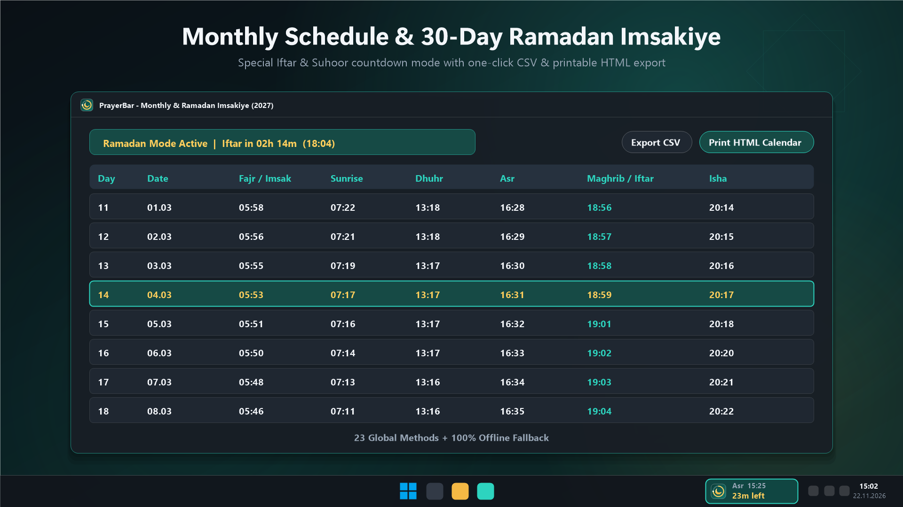
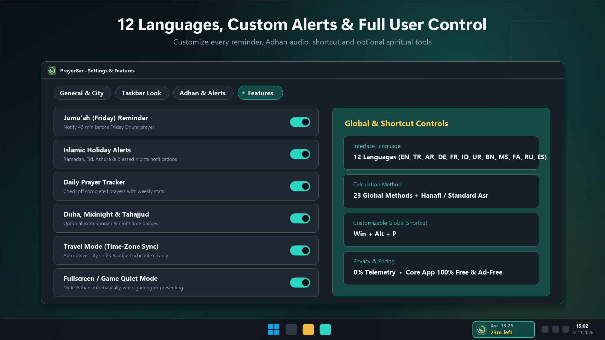

# PrayerBar

[-0078D4?logo=windows)](https://apps.microsoft.com/detail/9MSQBZTPGWX6)
[](#key-features)
[](#key-features)
[](#key-features)

**Ultra-lightweight (~3–5 MB RAM, 0% idle CPU) Windows 10/11 taskbar prayer times countdown, dynamic tray badge, Monthly/Ramadan Imsakiye & customizable Adhan notifications in 12 languages — never slows down your PC.**

- **Microsoft Store:** https://apps.microsoft.com/detail/9MSQBZTPGWX6
- **Website:** https://www.ooemir.com
- **Privacy Policy:** https://ooemir23.github.io/PrayerBar/privacy.html



---

## Screenshots

| Taskbar Countdown & ~3 MB RAM | 4 Fluent Flyouts & Live Qibla Compass |
| :---: | :---: |
|  |  |
| **Monthly Schedule & 30-Day Ramadan Imsakiye** | **12 Languages & Modular Features** |
|  |  |

---

## English Overview

### Why PrayerBar?
Many desktop prayer apps stay heavy in the background and consume hundreds of megabytes of memory. **PrayerBar** is designed to feel like a clean, built-in Windows 11 taskbar widget that never slows down your PC or drains laptop battery.

### Key Features
- **Never Slows Down Your PC:** Uses only ~3–5 MB RAM and 0% idle CPU, with instant startup and sleep/wake awareness.
- **Flexible Taskbar Integration:** 4 dock positions (near tray, far right, center, left) with `-500..+500 px` fine offset, 9 taskbar styles, 4 popup themes, and automatic Windows Light/Dark + Accent color sync.
- **Game & Fullscreen Quiet Mode:** Automatically mutes audio when you are gaming, watching videos, or presenting.
- **12 Languages (`Auto` OS Detection):** English, Türkçe, العربية, Deutsch, Français, Bahasa Indonesia, اردو, বাংলা, Bahasa Melayu, فارسی, Русский, Español (with full RTL layout support).
- **23 Global Calculation Methods:** Diyanet, MWL, ISNA, Umm al-Qura, Egyptian, Karachi, Singapore, France UOIF, Malaysia JAKIM, Indonesia KEMENAG, Russia, and more — plus Standard/Hanafi Asr and 100% offline calculation.
- **Ramadan & Daily Tools:** Automatic Ramadan Iftar/Suhoor countdown, Monthly Imsakiye (CSV/HTML export), live Qibla compass, Hijri date, optional Duha/Midnight/Tahajjud times, Friday & holiday reminders, Travel mode (timezone change alert), prayer tracking, and `Win+Alt+P` global hotkey.
- **Ethical Freemium & Ad-Free:** Zero ads and zero tracking. Core prayer times, daily notifications, built-in Adhan/chime sounds, and Monthly Imsakiye are **free forever**. Pro (`$4.99/yr` or `$9.99` lifetime via Microsoft Store, with a **14-day free trial**) unlocks extra taskbar styles, popup themes, custom audio files, and backup/restore.

---

## Türkçe Genel Bakış

Windows 10/11 görev çubuğunun istediğiniz bölümünde (sistem tepsisi yanı, en sağ / saatin sağ köşesi, orta veya sol) ve sistem tepsisinde çalışan, **bilgisayarınızı hiç yormayan (~3–5 MB RAM, boşta %0 CPU)** modern namaz vakitleri uygulaması.

### Öne Çıkan Özellikler
- **PC'yi Hiç Yormaz & Pil Dostu:** Yalnızca ~3–5 MB bellek ve %0 boşta CPU tüketir; eski laptoplarda dahi takılmadan, pil ömrünü koruyarak çalışır ve uyku/uyanma sonrası anında güncellenir.
- **Oyun & Tam Ekran Sessiz Modu:** Oyun oynarken, video izlerken veya sunum yaparken bildirim sesini otomatik susturur.
- **4 Görev Çubuğu Konumu & 9 Stil:** Sağ (tepsi yanı), En Sağ (opak arka planlı), Orta ve En Sol + `-500..+500 px` ince kaydırma ve 4 açılır pencere tasarımı.
- **Her Vakit İçin Ayrı Bildirim & Ücretsiz Ezan Sesleri:** 6 vaktin her biri için ayrı *Vaktinde bildir*, *Önce hatırlat (5–60 dk)* ve *Ses/Ezan* seçimi (kısa/uzun ezan, yumuşak çan, huzurlu zil veya kendi özel `.mp3`/`.wav` dosyanız).
- **23 Dünya Hesaplama Metodu + Otomatik Konum:** Diyanet, MWL, ISNA, Ümmü'l-Kura, Mısır, Karaçi, UOIF Fransa vb. tüm metotlar, Standart/Hanefi İkindi mezhebi, otomatik konum algılama ve internetsiz çalışma desteği.
- **12 Dilli Global Arayüz (`Auto` OS Dili Algılama):** English, Türkçe, العربية, Deutsch, Français, Bahasa Indonesia, اردو, বাংলা, Bahasa Melayu, فارسی, Русский, Español.
- **Ramazan İftar & Sahur Geri Sayımı + Aylık İmsakiye:** İmsakiye penceresi, CSV/HTML dışa aktarım ve otomatik Ramazan İftar/Sahur modu.
- **Etik Freemium & 14 Gün Ücretsiz Pro Deneme:** Reklamsız ve takipçisizdir. Çekirdek vakitler, günlük bildirimler, dahili ezan sesleri ve İmsakiye görüntüleme daima ücretsizdir. Pro (`$4.99/yıl` veya `$9.99 ömür boyu`, Türkiye'de `₺100 / ₺250`) 14 gün tam deneme sunar ve ekstra temalar ile özel ses/yedekleme özelliklerini açar.
- **Aç/Kapa Özellikler Sekmesi:** Cuma ve dini gün hatırlatmaları, seyahat modu (saat dilimi değişince uyarı), Ertele düğmeli Windows bildirimleri, Kuşluk / Gece yarısı / Teheccüd vakitleri, haftalık özetli namaz takibi ve `Win+Alt+P` kısayolu.
- **Sabah Ezanı Seçimi:** İmsak vakti için ayrı ses seçilebilir.

---

## Build, Test & Packaging

Requires `LLVM-MinGW UCRT` (`winget install MartinStorsjo.LLVM-MinGW.UCRT`).

```powershell
# Compile + run C++20 unit tests + verify PE security headers (ASLR/DEP/HighEntropyVA)
powershell -ExecutionPolicy Bypass -File scripts\build.ps1

# Runtime, memory & license smoke test
.\build\PrayerBar.exe --diag-smoke

# Render flyout preview BMPs in any language (--lang 1-12)
.\build\PrayerBar.exe --diag-smoke --lang 2 --flyout-preview C:\Temp\en

# Open Settings on a specific tab (0-4) in the running instance
.\build\PrayerBar.exe --settings 3

# Build Store (.msix) + Portable (.zip) + SHA256SUMS.txt under dist\release\
powershell -ExecutionPolicy Bypass -File scripts\build-release.ps1
```

---

## Documentation & Web Assets
- **Multi-Channel Marketing Kit (Reddit, Forums, Product Hunt):** [docs/MARKETING_KIT.md](docs/MARKETING_KIT.md)
- **Microsoft Store Publishing Guide:** [docs/MICROSOFT_STORE_GUIDE.md](docs/MICROSOFT_STORE_GUIDE.md)
- **Global Store Listings (ASO):** [docs/STORE_LISTINGS_GLOBAL.md](docs/STORE_LISTINGS_GLOBAL.md)
- **Global Launch Checklist:** [docs/GLOBAL_LAUNCH_CHECKLIST.md](docs/GLOBAL_LAUNCH_CHECKLIST.md)
- **Website & Privacy Policy:** [website/index.html](website/index.html), [website/privacy.html](website/privacy.html), [website/terms.html](website/terms.html)
