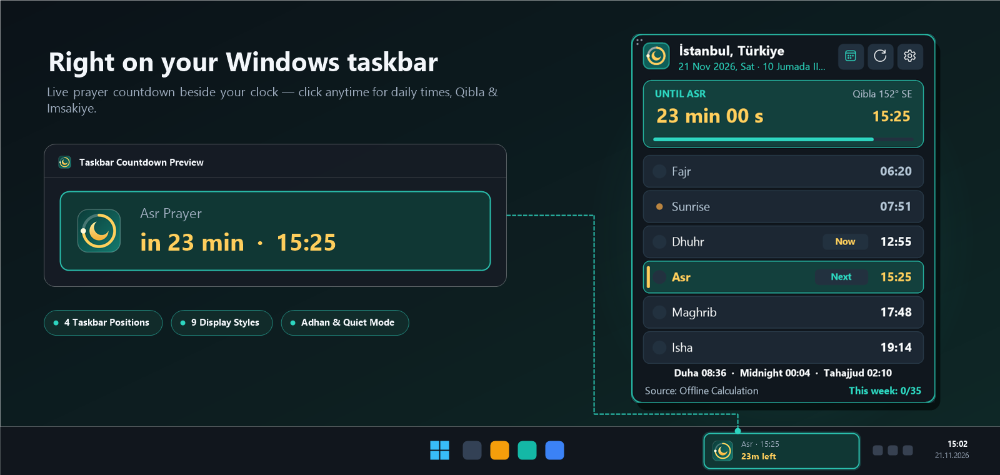
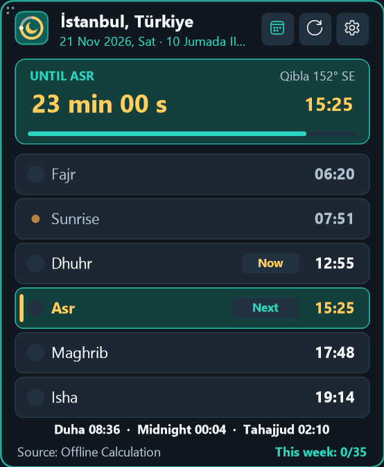
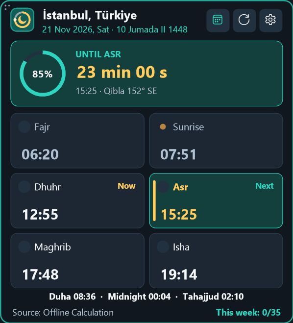
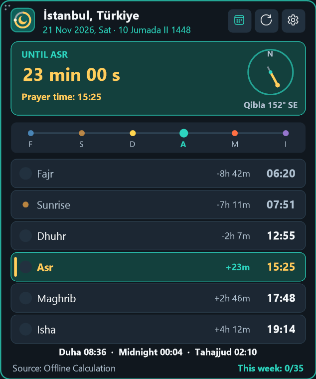

<div align="center">


<h1>PrayerBar</h1>

<p><strong>Accurate prayer times, Adhan reminders, Ramadan Imsakiye &amp; Qibla compass — right in your Windows 10/11 taskbar.</strong></p>

<p>Ad-free · Works offline · 12 languages · Lightweight &amp; gentle on your PC</p>

<p>
  <a href="https://apps.microsoft.com/detail/9MSQBZTPGWX6">
    
  </a>
  <a href="https://prayerbar.ooemir.com">
    
  </a>
  <a href="https://github.com/ooemir23/PrayerBar/releases">
    
  </a>
</p>

<p>
  
  
  
  
</p>

<p>
  <a href="#screenshots">Screenshots</a> ·
  <a href="#features">Features</a> ·
  <a href="#-türkçe">Türkçe</a> ·
  <a href="#whats-new-in-v2450">What's New</a> ·
  <a href="#build--development">Build from Source</a>
</p>

</div>

---

## Screenshots

<div align="center">
  
  <br />
  <sub><strong>Windows Taskbar Countdown &amp; Flyout</strong> — Always visible beside your system tray across 4 taskbar positions and 9 display styles</sub>
</div>

<br />

<table>
  <tr>
    <td align="center" width="33%">
      
      <br />
      <strong>Compact Fluent</strong>
      <br />
      <sub>Clean daily prayer list with next-prayer progress bar</sub>
    </td>
    <td align="center" width="33%">
      
      <br />
      <strong>2×3 Bento Cards</strong>
      <br />
      <sub>Circular countdown ring &amp; at-a-glance prayer grid</sub>
    </td>
    <td align="center" width="33%">
      
      <br />
      <strong>Timeline &amp; Live Qibla</strong>
      <br />
      <sub>Day timeline with live Qibla compass</sub>
    </td>
  </tr>
</table>

---

## Features

<table>
  <tr>
    <td valign="top" width="50%">
      <strong>🕌 Live Taskbar Countdown &amp; Widgets</strong><br />
      Always see the next prayer across 4 taskbar positions (tray, far right, center, left) with <code>-500..+500 px</code> offset, 9 taskbar styles, 4 popup themes, Windows Light/Dark &amp; accent sync, plus the Windows 11 Widgets Board (<code>Win+W</code>).
    </td>
    <td valign="top" width="50%">
      <strong>🔔 Customizable Adhan &amp; Reminders</strong><br />
      Per-prayer on-time alerts and 5–60 min pre-prayer reminders for all 6 times, with built-in Adhan &amp; peaceful chimes (including a separate Fajr/Imsak alert) or custom <code>.mp3</code>/<code>.wav</code> sounds.
    </td>
  </tr>
  <tr>
    <td valign="top" width="50%">
      <strong>🌙 Monthly &amp; Ramadan Imsakiye</strong><br />
      Automatic Ramadan Iftar &amp; Suhoor countdown, full monthly Imsakiye with CSV/HTML export, Hijri date, optional Duha / Midnight / Tahajjud times, prayer tracking, and Friday &amp; Islamic holiday reminders.
    </td>
    <td valign="top" width="50%">
      <strong>🧭 Live Qibla Compass &amp; Auto-Location</strong><br />
      Worldwide automatic location detection, instant offline city search, Travel Mode timezone alerts, live Qibla compass, and <code>Win+Alt+P</code> global shortcut.
    </td>
  </tr>
  <tr>
    <td valign="top" width="50%">
      <strong>🌍 23 Calculation Methods &amp; 12 Languages</strong><br />
      Diyanet, MWL, ISNA, Umm al-Qura, Egyptian, Karachi, Singapore, France UOIF, Malaysia JAKIM, Indonesia KEMENAG, Russia &amp; more (Standard/Hanafi Asr), in 12 languages with full RTL support (<code>Auto</code> OS detection).
    </td>
    <td valign="top" width="50%">
      <strong>🎮 Quiet Focus &amp; Gentle on Your PC</strong><br />
      Automatically mutes during games, fullscreen videos, or presentations. Runs quietly in the background without slowing down your computer or draining laptop battery — completely ad-free and offline-ready.
    </td>
  </tr>
</table>

> **Free Forever & Ethical Pro:** Zero ads and zero tracking. Core prayer times, daily Adhan alerts, built-in sounds, Qibla compass, and Monthly Imsakiye are **free forever**. **Pro** (`$4.99/yr` or `$9.99` lifetime via Microsoft Store, with a **5-day free trial**) unlocks extra taskbar styles, popup themes, custom audio files, and settings backup/restore.

---

## 🇹🇷 Türkçe

Windows 10/11 görev çubuğunda her an görebileceğiniz modern namaz vakitleri, ezan hatırlatıcısı, Ramazan imsakiyesi ve kıble pusulası — **reklamsız, internetsiz çalışır ve bilgisayarınızı yormaz.**

<table>
  <tr>
    <td valign="top" width="50%">
      <strong>🕌 Görev Çubuğu &amp; Widget Geri Sayımı</strong><br />
      4 görev çubuğu konumu (tepsi yanı, en sağ, orta, en sol) ve <code>-500..+500 px</code> ince kaydırma, 9 görev çubuğu stili, 4 açılır pencere teması, Windows Açık/Koyu ve vurgu rengi uyumu ile Windows 11 Widget Paneli (<code>Win+W</code>).
    </td>
    <td valign="top" width="50%">
      <strong>🔔 Özelleştirilebilir Ezan &amp; Hatırlatmalar</strong><br />
      6 vaktin her biri için ayrı vaktinde bildirim ve 5–60 dk önce hatırlatma; İmsak/Sabah için ayrı ses seçimi, dahili ezan ve huzurlu zil sesleri veya kendi özel <code>.mp3</code>/<code>.wav</code> dosyanız.
    </td>
  </tr>
  <tr>
    <td valign="top" width="50%">
      <strong>🌙 Ramazan İftar/Sahur &amp; Aylık İmsakiye</strong><br />
      Otomatik Ramazan İftar ve Sahur geri sayımı, CSV/HTML dışa aktarmalı aylık İmsakiye, Hicri tarih, Kuşluk / Gece yarısı / Teheccüd vakitleri, haftalık özetli namaz takibi, Cuma ve dini gün hatırlatmaları.
    </td>
    <td valign="top" width="50%">
      <strong>🧭 Canlı Kıble Pusulası &amp; Otomatik Konum</strong><br />
      Dünya genelinde otomatik konum algılama, internetsiz şehir arama, Seyahat Modu saat dilimi uyarısı, canlı Kıble pusulası ve <code>Win+Alt+P</code> kısayol tuşu.
    </td>
  </tr>
  <tr>
    <td valign="top" width="50%">
      <strong>🌍 23 Hesaplama Metodu &amp; 12 Dil</strong><br />
      Diyanet, MWL, ISNA, Ümmü'l-Kura, Mısır, Karaçi, Singapur, UOIF Fransa, JAKIM Malezya, KEMENAG Endonezya, Rusya ve daha fazlası (Standart/Hanefi İkindi), işletim sistemi dilini otomatik algılayan 12 dilli arayüz.
    </td>
    <td valign="top" width="50%">
      <strong>🎮 Oyun/Tam Ekran Sessiz Modu &amp; Sistemi Yormayan Yapı</strong><br />
      Oyun oynarken, video izlerken veya sunum yaparken bildirim sesini otomatik susturur. Arka planda sessizce çalışarak bilgisayarınızı yavaşlatmaz ve pil ömrünü korur — tamamen reklamsızdır.
    </td>
  </tr>
</table>

> **Ücretsiz & Etik Pro:** Reklam ve takip içermez. Temel namaz vakitleri, günlük ezan bildirimleri, dahili ezan sesleri, Kıble pusulası ve Aylık İmsakiye **daima ücretsizdir**. **Pro** (`₺100/yıl` veya `₺250 ömür boyu` · global `$4.99/yr` veya `$9.99`) **5 gün ücretsiz deneme** ile ekstra görev çubuğu stilleri, açılır pencere temaları, özel ses dosyaları ve ayar yedekleme/geri yükleme özelliklerini açar — <a href="https://apps.microsoft.com/detail/9MSQBZTPGWX6">Microsoft Store'dan İndir</a>.

---

## What's New in v2.4.5.0

- **Worldwide Automatic Location Detection:** Uses Windows Location with reverse geocoding, multi-provider HTTPS IP fallback, universal timezone mapping, startup retry backoff, and automatic timezone-change updates.
- **Seamless Microsoft Store Updates & Relaunch:** Cleanly handles Store updates in the background with automatic relaunch and reliable Windows startup across version upgrades.
- **Windows 11 Widgets & Fluent UI:** Includes the Windows 11 Widgets Board (`Win+W`), Fluent right-click context menu, crisp tray icons, and a 5-day free Pro trial.

---

## Build & Development

<details>
<summary><strong>Build, Test &amp; Packaging (for developers)</strong></summary>

Requires `LLVM-MinGW UCRT` (`winget install MartinStorsjo.LLVM-MinGW.UCRT`).

```powershell
# Compile + run C++20 unit tests + verify PE security headers (ASLR/DEP/HighEntropyVA)
powershell -ExecutionPolicy Bypass -File scripts\build.ps1

# Runtime, memory & license smoke test
.\build\PrayerBar.exe --diag-smoke

# Render flyout preview BMPs in any language (--lang 1-12)
.\build\PrayerBar.exe --diag-smoke --lang 2 --flyout-preview C:\Temp\en

# Open Settings on a specific tab (0-5) in the running instance
.\build\PrayerBar.exe --settings 3

# Build Store (.msix) + Portable (.zip) + SHA256SUMS.txt under dist\release\
powershell -ExecutionPolicy Bypass -File scripts\build-release.ps1
```

</details>

<details>
<summary><strong>Documentation &amp; Project Links</strong></summary>

- **Multi-Channel Marketing Kit (Reddit, Forums, Product Hunt):** [docs/MARKETING_KIT.md](docs/MARKETING_KIT.md)
- **Microsoft Store Publishing Guide:** [docs/MICROSOFT_STORE_GUIDE.md](docs/MICROSOFT_STORE_GUIDE.md)
- **Global Store Listings (ASO):** [docs/STORE_LISTINGS_GLOBAL.md](docs/STORE_LISTINGS_GLOBAL.md)
- **Global Launch Checklist:** [docs/GLOBAL_LAUNCH_CHECKLIST.md](docs/GLOBAL_LAUNCH_CHECKLIST.md)
- **Website &amp; Privacy Policy:** [website/index.html](website/index.html), [website/privacy.html](website/privacy.html), [website/terms.html](website/terms.html)

</details>

---

<div align="center">
  <a href="https://apps.microsoft.com/detail/9MSQBZTPGWX6">Microsoft Store</a> ·
  <a href="https://prayerbar.ooemir.com">Website</a> ·
  <a href="https://prayerbar.ooemir.com/privacy">Privacy Policy</a>
</div>
